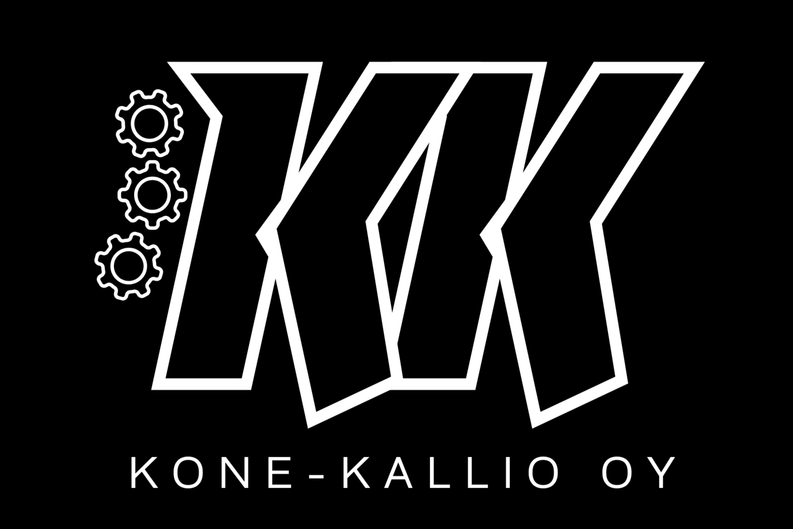

# Projektisuunnitelma

Sivusto tehdään rakennus- ja pihakoneita vuokraavalle Kone-Kallio-yritykselle. Tavoitteena on luoda selkeä ja helppokäyttöinen verkkosivusto, jonka avulla asiakkaat voivat tutustua yritykseen, vertailla vuokrattavia koneita ja lähettää vuokrauskyselyn.

Sivusto sisältää neljä sivua:

## Etusivu

Etusivulla esitellään yritys lyhyesti sekä kerrotaan sen tarjoamista palveluista. Sivulla on tervetuloteksti, kuva rakennuskoneesta sekä linkit sivuston muihin osioihin.

## Meistä

Meistä-sivulla kerrotaan yrityksestä, sen toiminnasta ja palveluista. Sivulla esitellään, millaisille asiakkaille palvelut on tarkoitettu sekä mitä etuja yritys tarjoaa asiakkailleen.

## Kalusto

Kalusto-sivulla esitellään vuokrattavat koneet taulukossa. Taulukosta käyttäjä näkee nopeasti koneen tyypin, painon, päivähinnan ja saatavuuden. Sivun tarkoituksena on helpottaa eri koneiden vertailua ja sopivan vaihtoehdon valintaa.

## Yhteystiedot

Yhteystiedot-sivulla näytetään yrityksen yhteystiedot, kuten puhelinnumero ja sähköpostiosoite. Sivulla on lisäksi vuokrauskyselylomake, jonka avulla asiakas voi lähettää tiedustelun haluamastaan koneesta ja vuokra-ajankohdasta.

##

Sivuston ulkoasu toteutetaan asiakkaan antaman värimaailman mukaisesti. Sivuston tulee olla selkeä, helposti navigoitava ja toimiva myös mobiililaitteilla.
